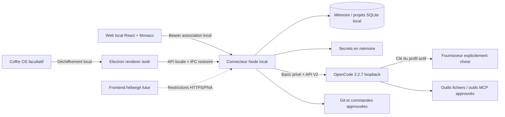

# Architecture Open Cortex Coder

Le produit sépare l'interface, le connecteur local, le moteur agentique et les ressources utilisateur. Le noyau de programmation est OpenCode CLI **2.2.7**; son client TypeScript **2.2.7** et ses contrats V2 contrôlent les sessions, outils, modèles et permissions. Aucun chatbot maison ne remplace la boucle agentique.

## Interface commune

React/Vite fournit un frontend statique partagé entre navigateur local, Desktop et hébergement facultatif. Monaco et ses workers sont intégrés au bundle sans CDN de code. Le layout propose fichiers/code/agent et panneaux de gestion. Une origine hébergée n'accède pas automatiquement à l'ordinateur utilisateur : elle démarre déconnectée et doit suivre le parcours explicite de pairing local.

Next.js n'apporte pas de gain de SSR à un IDE de projets privés et ajouterait une seconde couche serveur au packaging Desktop. L'interface conserve ses états de navigation et thèmes, mais ne conserve pas de clé fournisseur dans le stockage navigateur.

## Connecteur local

Le connecteur fournit les routes applicatives normalisées, contrôle les projets sélectionnés, les chemins, les permissions de mutation et la présence des secrets. Il détient seul le credential Basic d'OpenCode, dont les routes natives d'accès fichiers ne sont pas exposées directement au renderer. L'environnement du moteur et des commandes est nettoyé pour ne pas hériter des credentials du développement Manus.

Chaque projet est indépendant dans le Store local. Sessions et métadonnées gardent un identifiant OpenCode stable. Une session doit conserver son contexte et sa mémoire lorsque l'utilisateur choisit un autre modèle; un changement de fournisseur nécessite une décision explicite avant transmission de données.

Les modes Ask/Plan limitent les outils, et le mode Agent fait passer les mutations par des décisions ponctuelles. La configuration administrateur du connecteur doit dominer les configurations du dépôt. La sérialisation des opérations d'un même projet évite qu'une reconfiguration de permissions affecte une session concurrente. Les agents parallèles utilisent des projets worktrees distincts.

## Persistance et récupération

SQLite stocke les projets, profils sans clés, mémoires, documents, Skills, automatisations et résultats de commandes. La Knowledge Base utilise des passages indexés et une recherche locale pertinente; elle n'est pas présentée comme un RAG vectoriel distant ni comme une indexation exhaustive de tous formats binaires.

Les données OpenCode sont privées et séparées des données du produit. Aucune clé n'est stockée par la route native OpenCode de credentials. Le moteur reçoit des références d'environnement/configuration runtime nécessaires à son fournisseur. Ces valeurs existent en mémoire locale pendant les requêtes; voir les risques de commandes et d'accès du même utilisateur dans le rapport de sécurité.

## Git, MCP et automatisations

Git utilise les commandes locales et fournit statut/diff/historique/branches. Les checkpoints sont des copies bornées locales qui préservent l'index Git. Une restauration vérifie les versions courantes et demande une confirmation avant écrasement. Worktree ne constitue pas une isolation OS et n'est jamais suivi d'un merge implicite.

Le gestionnaire MCP utilise le contrat V2 réel. Les transports et statuts disponibles proviennent du moteur. Les templates de fournisseurs externes ne prouvent pas une authentification. Les APIs REST utilisent des profils sans secrets publics et des appels de test à méthodes de lecture explicites.

Le scheduler est local au connecteur et fonctionne uniquement pendant son activité. Les automatisations sans utilisateur doivent rester en lecture seule et ne pas répondre automatiquement aux permissions sensibles. GitHub s'appuie sur un CLI `gh` local déjà authentifié; les secrets des connecteurs Manus ne sont pas transférés automatiquement au produit.

## Desktop et distribution

Electron est retenu parce qu'OpenCode V2 l'utilise également et que la chaîne peut être vérifiée en TypeScript dans le sandbox. Le renderer reste sandboxé et sans Node; le main démarre le connecteur, choisit les dossiers et gère le coffre OS. Le binaire moteur est épinglé et embarqué. Aucun service de moteur n'est installé globalement ni exposé à Internet.

La distribution reste locale : projets et secrets ne sont pas synchronisés vers un backend éditeur. Une future synchronisation opt-in des métadonnées ou un runner isolé distant nécessiterait une extension séparée, documentée et vérifiée.
